# Learning a Handwriting Skill with DMPs: GMM-GMR vs Locally Weighted Regression (MATLAB)

**A robot learns to write the letter "G" from 5 human demonstrations. Replacing the standard locally weighted regression (WLR) forcing term of a Dynamic Movement Primitive with a Gaussian Mixture Model + Gaussian Mixture Regression (GMM-GMR) cuts reproduction error by about 15× (RMSE 5.16 → 0.35), and the learned skill is then executed on a simulated 2-link arm.**

| WLR (red) vs GMM-GMR (green) against the 5 demonstrations | Learned skill executed on a 2-link arm |
|:---:|:---:|
| 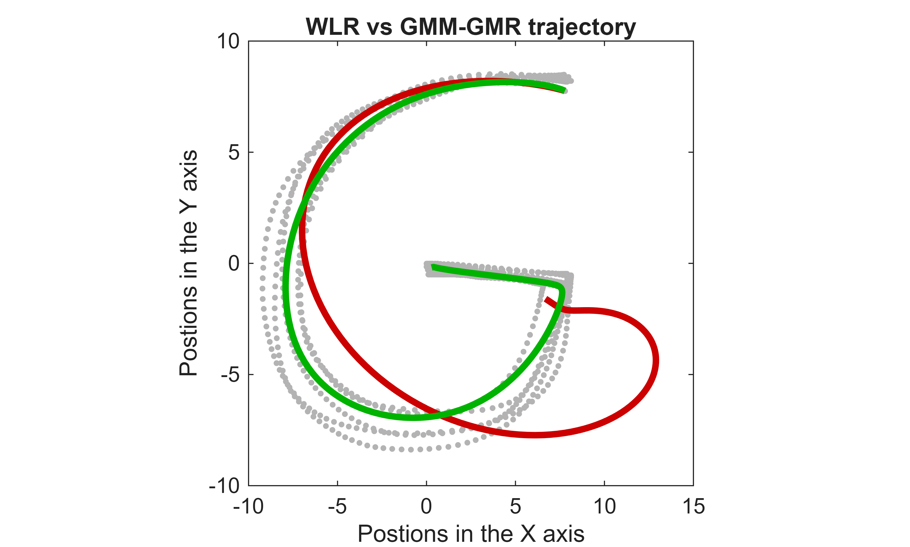 | 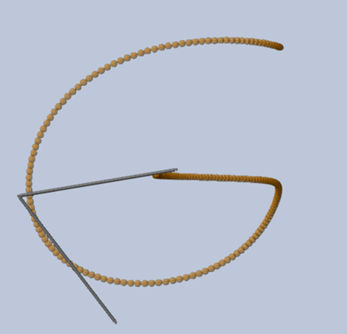 |

<!-- Add the YouTube link to the video walkthrough here -->

**Based on:** A. Hewitt, C. Yang, Y. Li, R. Cui, *DMP and GMR based Teaching by Demonstration for a KUKA LBR Robot*, IEEE ICAC 2017 ([DOI: 10.23919/IConAC.2017.8081982](https://doi.org/10.23919/IConAC.2017.8081982)). This repo reimplements the paper's DMP + GMM/GMR approach and extends it with a WLR baseline comparison, parameter studies (number of demonstrations, K, α, β, decay factor), goal generalisation, and execution on a simulated 2-link arm with computed-torque control.

---

## Overview

| Stage | What it does |
|---|---|
| Learning from demonstration | 5 handwritten "G" demonstrations (200 samples each) → DMP forcing term |
| Forcing-term learner | Baseline: RBF kernels + locally weighted regression (WLR). Proposed: GMM (EM) + GMR |
| Generalisation | Forcing term scaled by s·(g − x₀) so the skill adapts to new goals |
| Evaluation | RMSE vs number of demonstrations, vs number of kernels/Gaussians; effect of α, β, decay factor |
| Robot execution | Inverse kinematics (elbow-down) → kinematic simulation → dynamic simulation with feedback-linearisation + PD control (Simulink) |

---

## Method

### Dynamic Movement Primitive

The DMP is a spring-damper system pulled towards the goal g and shaped by a learned forcing term f(s), where s is a decaying phase variable:

$$\ddot{x} = \beta\,(g - x) - \alpha\,\dot{x} + s\,(g - x_0)\,f(s)$$

During learning, the forcing term is extracted from each demonstration and divided by s·(g − x₀). During reproduction it is multiplied back. This is the standard DMP spatial-scaling formulation (Ijspeert et al., Neural Computation 2013) and is what lets the letter adapt to a new goal.

### Forcing term: WLR baseline vs GMM-GMR

- **WLR:** K Gaussian basis functions at fixed, equally spaced centres in s, each with a weight fitted by weighted least squares ([`SkillGeneralisation.m`](matlab/SkillGeneralisation.m)).
- **GMM-GMR:** fit a K-component GMM on the joint data [s, f] with EM, then regress f given s ([`MixtureGaussians.m`](matlab/MixtureGaussians.m)). Unlike the fixed RBFs, the Gaussians learn their own centres, widths and correlations from the data, and GMR also gives a variance at every point:

$$h_k(s) = \frac{\pi_k\,\mathcal{N}(s \mid \mu_k^s, \Sigma_k^{ss})}{\sum_j \pi_j\,\mathcal{N}(s \mid \mu_j^s, \Sigma_j^{ss})}, \qquad \hat{f}(s) = \sum_k h_k(s)\left[\mu_k^f + \Sigma_k^{fs}\,(\Sigma_k^{ss})^{-1}(s - \mu_k^s)\right]$$

| EM convergence | GMM components (top) and GMR with confidence band (bottom) |
|:---:|:---:|
| 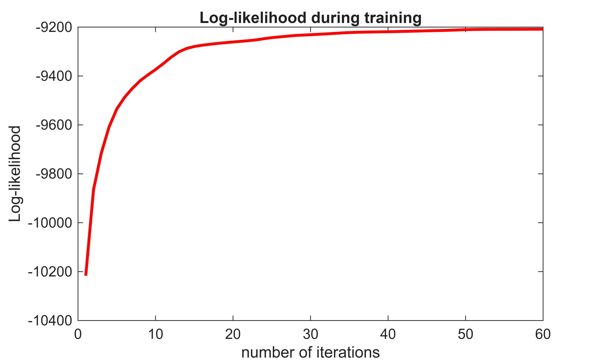 | 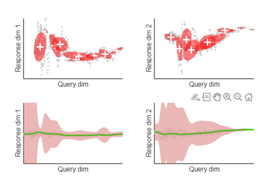 |

EM converges in about 50 iterations. The confidence band shows where the demonstrations agree (narrow) and where they vary (wide).

---

## Results

All RMSE values are against the mean demonstration (200 samples).

### WLR vs GMM-GMR (K = 9, 5 demonstrations)

| Method | RMSE | Max error |
|---|:---:|:---:|
| WLR (RBF + weighted least squares) | 5.16 | 7.41 |
| **GMM-GMR** | **0.35** | **0.84** |

### Number of demonstrations

| Demos | WLR RMSE | GMM-GMR RMSE |
|:---:|:---:|:---:|
| 1 | 4.26 | fit failed |
| 2 | 4.64 | 1.36 |
| 3 | 4.80 | 0.66 |
| 4 | 4.76 | 0.36 |
| 5 | 5.16 | **0.35** |

| WLR | GMM-GMR |
|:---:|:---:|
| 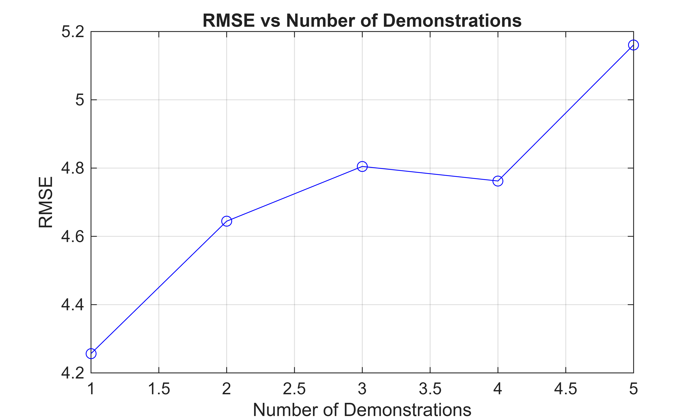 | 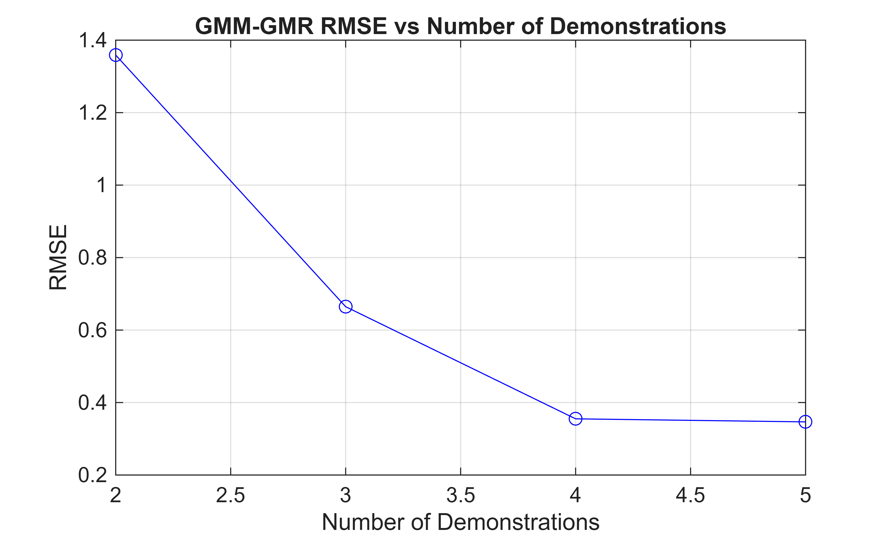 |

GMM-GMR improves steadily with more demonstrations and levels off at 4–5. WLR does not improve: its fixed-width kernels cannot adapt, so small timing differences between demonstrations get averaged into a smeared trajectory.

### Number of kernels / Gaussians (K)

| K | 3 | 5 | 7 | 9 | 12 | 15 | 20 | 30 | 50 |
|---|:-:|:-:|:-:|:-:|:-:|:-:|:-:|:-:|:-:|
| WLR RMSE | 6.09 | 5.05 | **4.77** | 5.16 | 6.07 | 6.82 | 7.65 | 8.50 | 9.11 |
| GMM-GMR RMSE | 0.86 | 0.43 | **0.34** | 0.44 | 0.35 | 0.36 | 0.36 | 0.38 | fit failed |

| WLR | GMM-GMR |
|:---:|:---:|
| 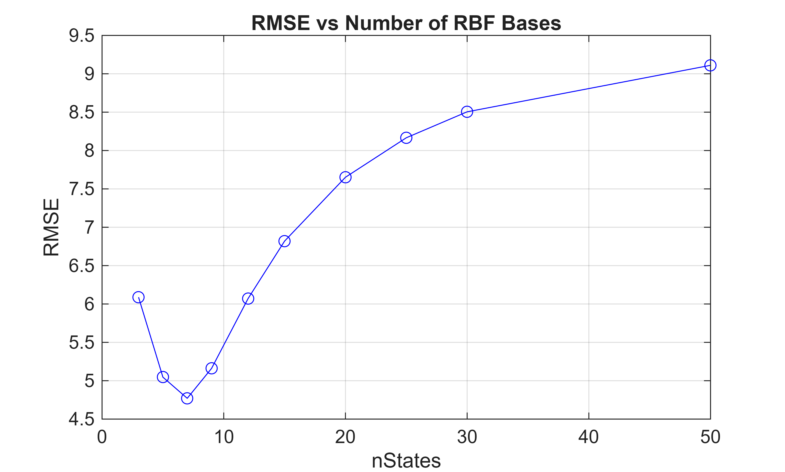 | 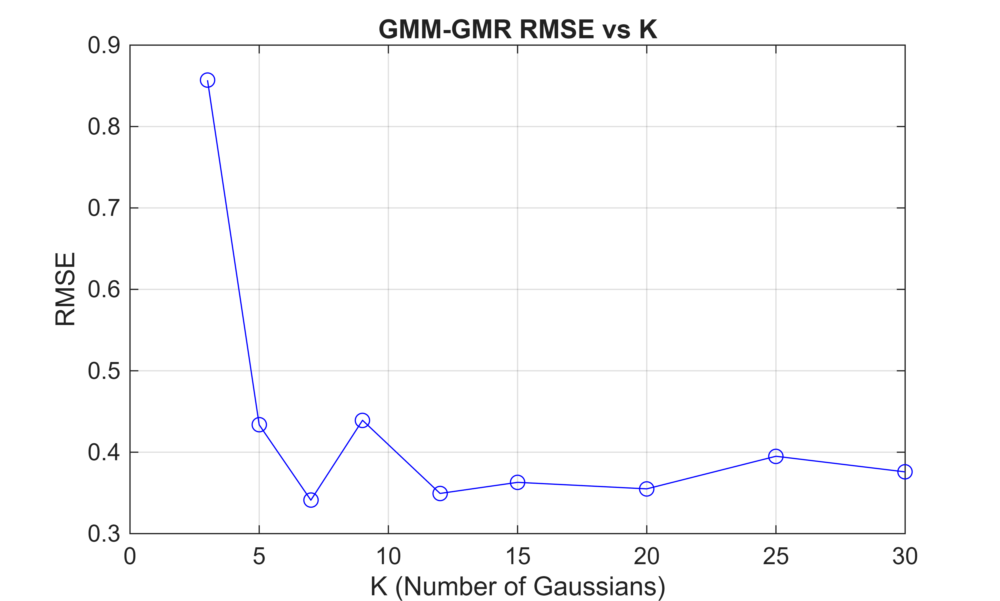 |

Both methods are best at K = 7. Even at K = 3, GMM-GMR (0.86) beats WLR's best (4.77). Too few components underfit; too many overfit to noise in the demonstrations.

### Generalising to a new goal

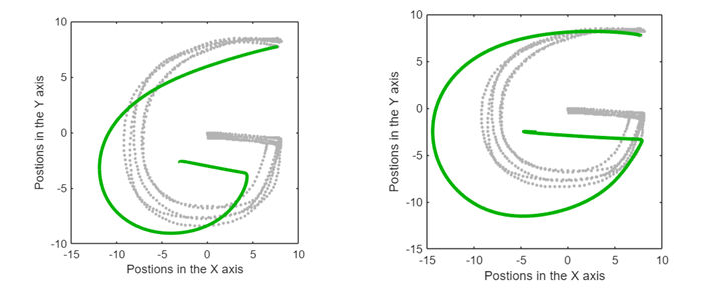

Moving the goal to (−3, −3): without the s·(g − x₀) scaling (left) the letter distorts; with it (right) the "G" keeps its shape. The scaling is per axis, so the shape is stretched slightly unevenly (≈1.40× in x, 1.30× in y here).

### Robot execution

The learned trajectory is shifted into the workspace of a planar 2-link arm, converted to joint angles with analytic inverse kinematics (elbow-down), and tracked in Simulink by a computed-torque (feedback-linearisation) controller with critically damped PD poles at −130 (joint 1) and −110 (joint 2).

| Kinematics only | With dynamics |
|:---:|:---:|
| 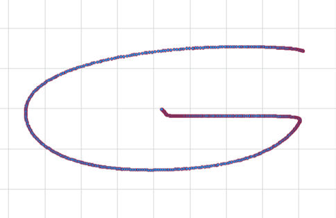 | 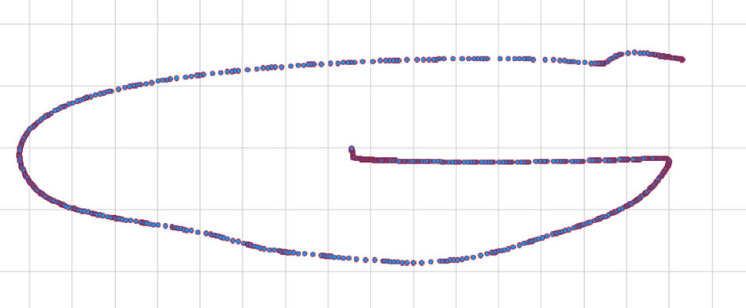 |

| Joint 1 torque | Joint 2 torque |
|:---:|:---:|
| 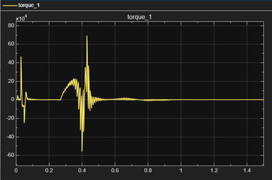 | 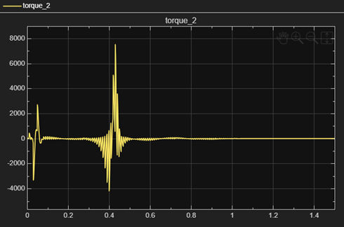 |

The arm draws the letter, but **executing it in 1 s is not physically feasible**: joint 2 approaches 180° around 0.3 s (near a singularity), and torques exceed 60,000 N·m there. The small bend in the dynamic trajectory comes from inertia that even a high-gain controller cannot fully cancel.

---

## Repository structure

```
dmp-gmm-gmr-skill-learning/
├── README.md
├── matlab/
│   ├── run_dmp_gmm_gmr.m        # plain script: learning, evaluation, export for simulation
│   ├── dmp_gmm_gmr.mlx          # live script with write-up and figures
│   ├── SkillGeneralisation.m    # DMP class: forcing term, WLR, GMR, rollout, evaluation
│   ├── MixtureGaussians.m       # GMM (EM) + GMR implementation
│   ├── RobotSimulation.slx      # 2-link arm: IK, kinematics, computed-torque control
│   └── Demonstrations.mat       # handwritten "G" demonstrations
└── figures/
    ├── learning/
    ├── evaluation/
    └── robot/
```

## How to run

**Requirements:** MATLAB (R2024b or later recommended), Simulink, and the Statistics and Machine Learning Toolbox (`mvnpdf` is used in GMR).

1. `cd matlab` and run `run_dmp_gmm_gmr.m` (or open `dmp_gmm_gmr.mlx` for the full write-up).
2. The last section writes `SimData.mat`. Open `RobotSimulation.slx` and press **Run** to execute the learned "G" on the 2-link arm.

